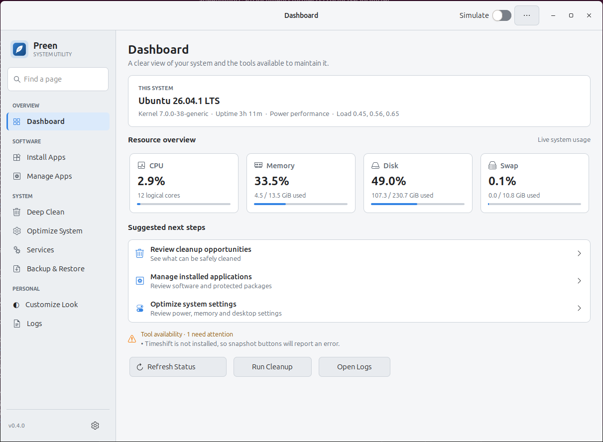
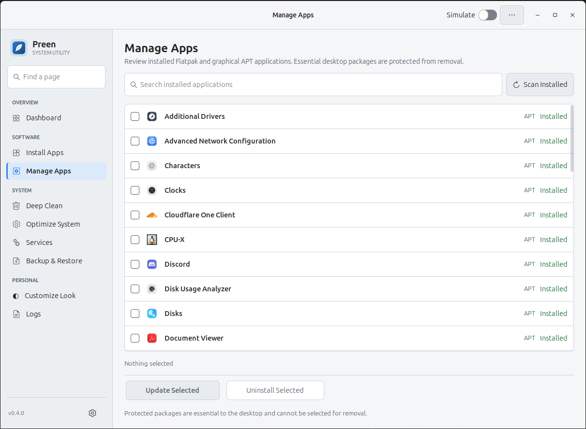

# Preen — Linux system utility for apps, cleanup and maintenance

Preen is an open-source Linux desktop utility for managing APT and Flatpak
applications, reviewing disk cleanup, inspecting systemd services and backing up
user configuration. It brings these tools together in a native Python and GTK 3
interface for Ubuntu-family and Debian-based desktops.

**Start here:** [Run from source](#run-from-source) · [User guide](docs/USER_GUIDE.md) ·
[Privacy](PRIVACY.md) · [Security](SECURITY.md) ·
[Releases](https://github.com/mdadeel/Preen/releases)

## Screenshots





These user-provided screenshots show one example system. The operating system,
resource readings, installed apps and available actions vary by machine; they
are not live data or guarantees of compatibility.

## What can Preen do?

| Area | What is available in the current source |
|---|---|
| **Dashboard** | Review system information, resource usage and missing tools; open common maintenance pages. |
| **Install Apps** | Search a curated catalogue, select APT or Flatpak, use presets and install or update apps. A source fallback is available where the catalogue provides one. |
| **Manage Apps** | Search installed Flatpaks and graphical APT packages, select apps for removal and see protected package rows. |
| **Deep Clean** | Review selected cache, trash and journal cleanup targets with measured sizes or estimates before confirming deletion. |
| **Optimize System** | Manage supported power profiles, animations, startup entries, swap and ZRAM settings when their system tools are available. |
| **Services** | Inspect systemd services, filter the list and request supported service actions; stop, disable and restart require confirmation. |
| **Backup & Restore** | Export and restore user configuration archives; use Timeshift where installed. |
| **Customize Look** | Choose Preen's own light, dark or system appearance. Separate, confirmed controls can also change desktop text scaling, icon themes and GTK 3 corner styling. |
| **Logs** | Filter, select, copy, clear and save diagnostic output; command failures include exit details. |

Availability depends on the distribution, installed tools, permissions and the
selected operation. See the [user guide](docs/USER_GUIDE.md) for details and
[product roadmap](docs/PRODUCT_ROADMAP.md) for ideas that are **not yet
implemented**, including the proposed folder organizer.

## Use maintenance tools carefully

1. Back up important data and review the affected packages, files or services.
2. Turn on **Simulate** before trying a maintenance action. Supported system
   changes are previewed instead of applied; inspect **Logs** for the result.
3. Confirm the operation and turn Simulate off only when you are ready to make
   the real change. Some actions require authorization through polkit.

Simulate is **not a no-write sandbox**: read-only checks still run, saving
preferences or a log can write files, and loading old settings may migrate the
legacy configuration directory. A simulated command does not reveal every
package-manager dependency change. Cleanup sizes are measurements or estimates,
not a promise of space reclaimed. Preen's direct app-uninstall paths block a
defined set of essential APT package names, but APT autoremove and dependency
changes can affect other packages. No list can guarantee an operation is
risk-free. Read the [safety and security guidance](SECURITY.md) first.

## Requirements

- Linux with Python **3.8 or newer**, GTK 3 and PyGObject. A graphical desktop is
  required for the GUI; the doctor and catalogue checks are headless.
- APT/dpkg features target Debian and Ubuntu-family distributions, including
  derivatives such as Zorin OS, Linux Mint and Pop!_OS. Other Linux systems may
  run parts of Preen but APT-specific features need APT/dpkg and have not been
  established as universally supported.
- Flatpak, polkit, systemd, GNOME settings, Timeshift, power profiles and ZRAM
  tooling are needed only for the features that use them. Feature and desktop
  availability varies; run the doctor to see what is missing.

### Run from source

On a Debian/Ubuntu-family system, install the Python/GTK packages, clone the
repository and start with Simulate enabled:

```bash
sudo apt update
sudo apt install -y git python3 python3-gi gir1.2-gtk-3.0 python3-psutil

git clone https://github.com/mdadeel/Preen.git
cd Preen
python3 -m preen_tool.app --doctor
python3 -m preen_tool.app --simulate
```

Install optional tools for the features you need; the
[user guide](docs/USER_GUIDE.md#optional-tools) gives examples. If your default
`python3` is not the distribution's Python and cannot import `gi`, use the
system Python, for example `/usr/bin/python3`, with the same commands.

### Releases and local packages

Check [GitHub Releases](https://github.com/mdadeel/Preen/releases) for the
assets attached to a particular release. The `v0.4.0` release had source
archives but **no attached Debian or AppImage binaries** when this document was
updated on 2026-10-28. The current source may contain changes not in that tag.

To build a Debian package from a checkout with `dpkg-deb` installed:

```bash
./packaging/build_deb.sh
# Install the versioned file reported by the builder, for example:
sudo apt install ./dist/preen_0.4.0_all.deb
```

To build the x86-64 AppImage, run `./packaging/build_appimage.sh`; the builder
may download `appimagetool` without checksum verification. Prefer a trusted,
pre-verified tool supplied through `APPIMAGETOOL`. The AppImage uses the
host's Python, GTK and PyGObject rather than bundling them. A Python virtual environment with
`--system-site-packages` can also be used for an editable install; see the
[contributor guide](CONTRIBUTING.md#get-set-up).

## Command-line checks

From a source checkout use `python3 -m preen_tool.app`; after installing the
package, use `preen` instead:

```bash
python3 -m preen_tool.app --doctor          # dependency and capability report
python3 -m preen_tool.app --doctor --json   # machine-readable report
python3 -m preen_tool.app --check-catalog    # validate app and preset data
python3 -m preen_tool.app --version
python3 -m preen_tool.app --simulate        # start the GUI in Simulate mode
```

Doctor reports and logs can contain local paths, app names and diagnostic
output. Review and redact them before sharing.

## Frequently asked questions

### What is Preen?

Preen is an open-source GTK 3 utility that brings Linux app management, cleanup,
service controls, configuration backups and selected system settings into one
desktop interface. It uses existing system tools rather than replacing them.

### Is Preen free and open source?

Preen's project code is available under the [MIT License](LICENSE). Bundled
third-party artwork has separate terms; see [third-party notices](THIRD_PARTY_NOTICES.md).

### Does Preen work on my Linux distribution?

APT-related features are intended for Debian and Ubuntu-family systems.
Flatpak, GNOME, systemd and other features require the corresponding tools and
desktop support. Preen is not verified on every distribution or configuration;
run `--doctor` and test carefully on your own system.

### Does Preen collect or send my data?

The current desktop app has no built-in telemetry or analytics and does not
send diagnostic logs to the Preen maintainers. APT, Flatpak, Flathub setup and
other external tools may contact their own repositories or services. Local
settings, exported archives and logs can contain sensitive information; read
the [privacy policy](PRIVACY.md) before sharing or deleting them.

### Do I need administrator privileges?

Run Preen as your normal user. System-level changes, such as APT, swap and
system service operations, can ask for authorization through polkit; the
specific prompt and permissions depend on the operation and system.

### Does Preen change the theme of my whole desktop?

The Preen appearance selector changes Preen only. Other controls are explicitly
labelled desktop-wide: text scaling and icon themes can affect the GNOME
desktop, and rounded-corner CSS can affect GTK 3 apps. Review and confirm those
changes separately.

### Can Preen organize files in a folder?

Not yet. A selectable-folder organizer is a proposal in the
[product roadmap](docs/PRODUCT_ROADMAP.md), not a current feature.

## Documentation and community

- [User guide](docs/USER_GUIDE.md) · [Documentation index](docs/README.md) ·
  [Architecture](docs/ARCHITECTURE.md) · [Changelog](CHANGELOG.md)
- [Contributing](CONTRIBUTING.md) · [Code of conduct](CODE_OF_CONDUCT.md) ·
  [Report a bug](https://github.com/mdadeel/Preen/issues)
- [Privacy policy](PRIVACY.md) · [Security policy](SECURITY.md) ·
  [Third-party notices](THIRD_PARTY_NOTICES.md) · [MIT License](LICENSE)
- [Product roadmap](docs/PRODUCT_ROADMAP.md) ·
  [Proposed website plan](docs/WEBSITE_PLAN.md)

For sensitive security issues, follow [SECURITY.md](SECURITY.md) rather than
posting exploit details or personal data in a public issue. Automated tests use
fakes and do not substitute for validation on a supported live GNOME desktop;
see the [functional review](docs/FEATURE_AUDIT.md) for test limitations.
