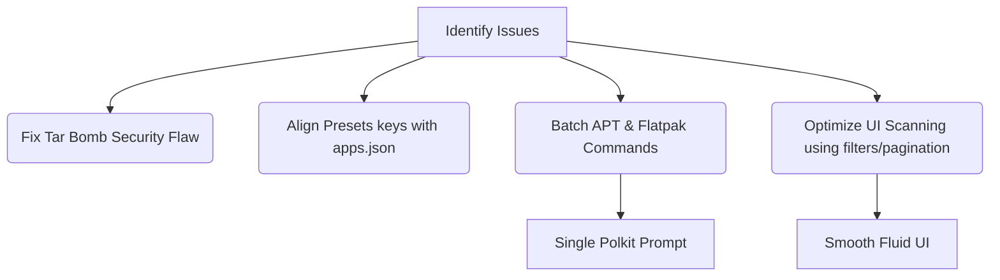

# ZorinOS Optimizer - Code Review & Audit Report

> **Historical document (v0.1.0 audit).** Most items below were addressed in
> that release; several claims (notably the preset keys) were already stale
> when this file was committed. For the current, verified audit and the full
> fix list see **[ROAST.md](ROAST.md)**.

A detailed code review of the **ZorinOS Optimizer** project, detailing critical security vulnerabilities, functional bugs, responsiveness issues, and suggested architectural fixes.

---

## 🚨 Critical Bugs & Vulnerabilities

### 1. Path Traversal Vulnerability (Tar Bomb) in Config Restore
* **Location:** [`zorin_optim_tool/backend/backup.py`](file:///home/adeel/Documents/projects/ZorinOS-Optimizer/zorin_optim_tool/backend/backup.py#L16-L29)
* **Description:** The `import_configs` function attempts to check if tar members are within the target `~/.config` directory via `is_within_directory`. However, the return value is ignored, and the function unconditionally extracts the whole archive to the parent of `~/.config` (i.e. `~/`) using `tar.extractall()`.
* **Impact:** A malicious backup tarball can use directory traversal (e.g. `../../.bashrc`) to overwrite arbitrary files in the user's home folder or system, leading to code execution.

### 2. Broken Presets for Gamer and Creative Packs
* **Location:** [`zorin_optim_tool/config/presets.json`](file:///home/adeel/Documents/projects/ZorinOS-Optimizer/zorin_optim_tool/config/presets.json#L3-L4) vs [`zorin_optim_tool/config/apps.json`](file:///home/adeel/Documents/projects/ZorinOS-Optimizer/zorin_optim_tool/config/apps.json)
* **Description:** The presets map application identifiers. However:
  * `Gamer Pack` lists flatpak ref IDs (`com.valvesoftware.Steam`) instead of the app keys defined in `apps.json` (`steam`).
  * `Creative Pack` lists a mix of keys (`gimp`, `obs`) and flatpak refs (`org.kde.krita`, `org.inkscape.Inkscape`) instead of the correct keys (`krita`, `inkscape`).
* **Impact:** Applying these presets fails to check the corresponding applications in the GUI, rendering the presets non-functional.

---

## ⏳ Performance & Threading Bottlenecks

### 1. UI Freeze on Package Scanning
* **Location:** [`zorin_optim_tool/app.py`](file:///home/adeel/Documents/projects/ZorinOS-Optimizer/zorin_optim_tool/app.py#L340-L364)
* **Description:** `on_scan_installed` scans both Flatpaks and *all* installed APT packages. A typical Debian/Ubuntu/Zorin installation has **1500 to 3000+** installed APT packages. The worker constructs and adds these thousands of `Gtk.ListBoxRow` instances in a single `GLib.idle_add` block.
* **Impact:** The main UI thread freezes completely for several seconds while Gtk renders thousands of widgets. The list also becomes completely unusable for the user due to clutter (e.g. listing libraries, compilers, system packages).

### 2. Thread-Blocking GUI Execution
* **Location:** [`zorin_optim_tool/backend/backup.py`](file:///home/adeel/Documents/projects/ZorinOS-Optimizer/zorin_optim_tool/backend/backup.py#L38-L40)
* **Description:** `open_timeshift_gui` runs `timeshift-gtk` via `run_cmd`, which uses `proc.communicate()`. 
* **Impact:** The background thread is blocked indefinitely until the user closes the Timeshift window, wasting resource handles and potentially delaying other queued actions.

---

## 👤 User Experience & Polkit Issues

### 1. Polkit Fatigue (Multiple Consecutive Password Prompts)
* **Location:** [`zorin_optim_tool/backend/performance.py`](file:///home/adeel/Documents/projects/ZorinOS-Optimizer/zorin_optim_tool/backend/performance.py#L25-L35)
* **Description:** Creating a swapfile runs 5 sequential commands, each prefixed with `pkexec` (e.g., `fallocate`, `chmod`, `mkswap`, `swapon`, writing to `/etc/fstab`).
* **Impact:** The user is prompted for their password 5 separate times in succession. This is extremely annoying and insecure (trains users to blindly type passwords).

### 2. Individual Command Execution (No Batching)
* **Location:** [`zorin_optim_tool/backend/apps.py`](file:///home/adeel/Documents/projects/ZorinOS-Optimizer/zorin_optim_tool/backend/apps.py#L92-L121)
* **Description:** Uninstalling or upgrading selected packages iterates through each package and spawns `pkexec apt-get remove/install` or `flatpak uninstall` individually.
* **Impact:** Spawning APT sequentially creates a Polkit prompt for each package, locks/unlocks the dpkg database repeatedly, and wastes time.

---

## 🛠️ Recommended Action Plan

### 📋 Priority Fixes

1. **Secure Extract in `backup.py`:**
   Filter or sanitize members in the tarball, or pass a filter function to `extractall` (on Python 3.12+) to block path traversal.
2. **Fix `presets.json` Keys:**
   Update `presets.json` to map strictly to the application IDs (e.g., `steam`, `lutris`, `krita`, `inkscape`) defined in `apps.json`.
3. **Batch Package Commands:**
   Collect all selected APT packages and flatpaks into single command invocations:
   * `pkexec apt-get remove -y pkg1 pkg2 pkg3`
   * `flatpak uninstall -y id1 id2 id3`
4. **Group Swapfile Tasks:**
   Combine swapfile setup commands into a single script block run through one `pkexec bash -c "..."` invocation.
5. **Apt List Filtering:**
   Instead of scanning *all* installed packages via `dpkg-query`, filter for manually installed graphical applications (e.g., checking desktop files) or limit search to items listed in `apps.json`.
